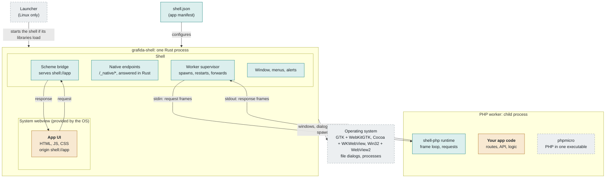
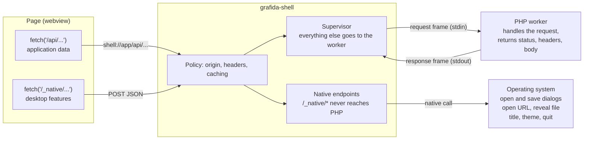

# Architecture

How Grafida Shell fits into a desktop application built on it, and how the application talks to it.

## Where the shell sits

At run time the shell is the parent process. It owns the window, borrows the operating system's webview to show your UI, and starts your PHP code as a child process. The shell contains nothing specific to your application: `shell.json` supplies the name, scheme, window size and worker command.

Teal is the shell (generic), amber is your application, dashed grey is the operating system or a bundled runtime.

## How the application talks to the shell

The page has a single door: every request goes to `shell://app` (or whatever scheme `shell.json` names).

- Requests for `/_native/*` end at the shell and become operating system calls such as file dialogs. The result goes back to the page as JSON.
- All other requests become length-prefixed frames on the worker's stdin. The worker's reply frame comes back on stdout and the shell hands it to the page as an ordinary HTTP response. The page never learns that the worker is a separate process.
- The UI thread never waits on the worker. Answers are posted back to it and completed there.

The frame format is specified in the [wire protocol v1](../../protocol/v1.md); the reasoning behind the stack is in [ADR 0001](../adr/0001-shell-stack.md).
